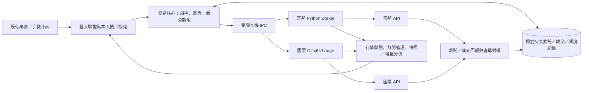
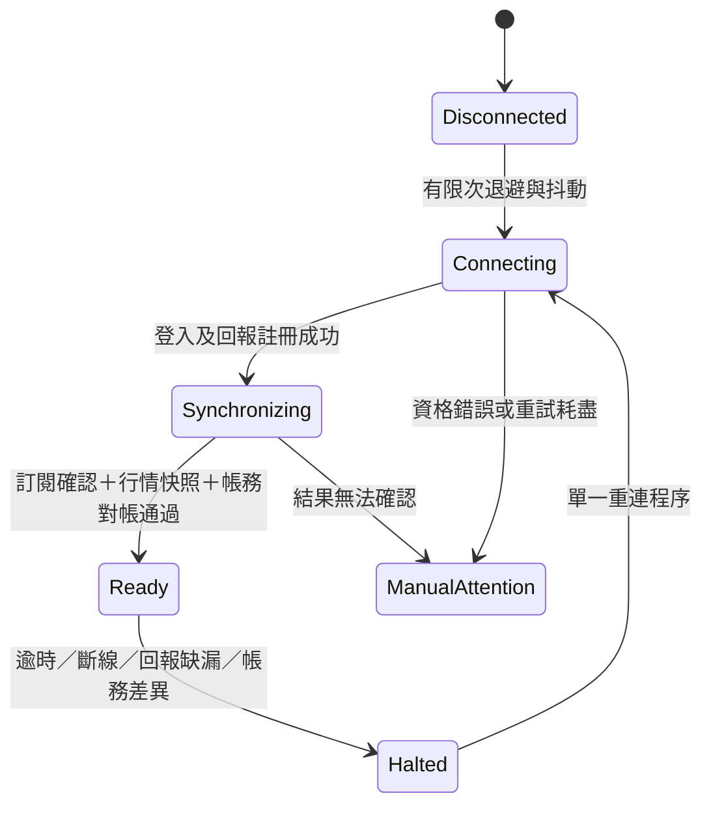

# 國票／富邦台股 API 串接與可靠性計畫

日期：2026-10-23（台北）。使用者已確認：**本人自己的國票、富邦台股證券帳戶**。本文件與同次加入的基礎程式，處理未來真實 API 接入；不是正式交易已啟用的證明。

後續進度：同日另完成並發布 [富邦盤中唯讀行情](./fubon-readonly-2026-10-23.md)，驗證真實登入、快照、重連與本人權限。下方「本次」現況表保留原始規劃階段的檢查時間點；富邦行情最新實作與驗收以連結文件為準。國票與真實下單仍未啟用。

## 1. 本次結論與現況

介面可以沿用，但真實交易需要獨立的交易核心、券商橋接服務、持久紀錄與回報對帳。不能把現在的模擬 `BrokerPort.place()` 換成一次 HTTP 呼叫，就認為串接完成。

無法保證網路、主機與券商永不故障。可設計並驗收的是：**故障時不盲目重送、不把結果不明當失敗、不讓過期或錯股報價繼續作為下單依據，並保留可查證的恢復路徑。** 本地一次派送限制不等於券商提供 exactly-once 保證。

| 項目 | 目前檢查結果 |
| --- | --- |
| `src/lib/broker/index.ts` | 模擬介面同步回傳撮合結果；實盤 `ready=false` |
| `src/routes/api/broker/order.ts` | 501；本次補上穩定錯誤碼 `LIVE_LOCKED`、`retryable=false`、禁止快取；沒有券商呼叫 |
| `src/lib/morning-live.ts` | 目前畫面逐筆跳動由歷史分鐘內的教學重播產生；真實串流必須另設資料通路 |
| `src/lib/morning-quote.ts`、`morning-book.ts` | 模擬教室的價格／示意五檔；不能拿來補缺少的正式報價 |
| `tools/fubon-daily` | 獨立盤後唯讀收集程式；原有排程、登入設定及安裝複本不在本次修改範圍 |
| `src/lib/broker/reliability` | 本次新增可離線驗證的訂單紀錄、事件處理、報價檢查、訂閱管理基礎 |
| 正式網站與券商 | 本次未部署、未讀取帳密／憑證、未登入券商、未送出真實委託 |

第一版收斂為上市／上櫃**普通股、整張、現股、限價 ROD、本人手動送單**。股票是否可交易仍須商品主檔與帳戶權限確認；四位代號不是交易資格證明。零股、ETF、融資融券、先賣後買、IOC/FOK、市價、條件單及期貨不隨本版自動開啟。當沖資格、可賣股數及交易類別需逐項通過券商驗收後再開放。

## 2. 官方能力與選型

以下是當日查到的官方資料；數字是當前文件值，不是帳戶核准結果或未來版本保證。

| 券商 | 已確認官方能力／條件 | 建議接法 | 還要取得／驗收 |
| --- | --- | --- | --- |
| 富邦 | Neo API 支援 Python、C#、Node.js；行情有 Web API、WebSocket；提供證券測試帳號 | 獨立 Python worker 與 venv，利用既有 Python 經驗；與盤後 collector 分開生命週期與權限 | 本人 API 資格、測試帳號、實際 SDK 版本、欄位與 callback 語義、庫存／額度與完整回報 |
| 國票 | 需申請、簽署同意書、測試驗證核准；64 位元 Windows、.NET Framework 4.7.2+，可呼叫 Windows DLL 的語言 | 獨立 Windows x64 C# bridge，依核准元件及官方範例選定確切 .NET 目標版本 | 最新 DLL／文件／雜湊、行情元件、測試環境與帳號、主動回報註冊、查單補報、節流與自動重連行為 |

來源：[富邦快速上手與測試環境](https://www.fbs.com.tw/TradeAPI/docs/welcome/)、[富邦版本相容性](https://www.fbs.com.tw/TradeAPI/docs/install-compatibility/)、[國票申請與系統需求](https://www.ibfs.com.tw/wealth-ap/download/api.aspx?xt=1&xy=3)、[國票交易文件入口](https://www.ibfs.com.tw/IBFS_API/ibfs-api-trade.aspx?xt=2&xy=1)。

富邦文件目前列出：交易連線 10、下單 50 次／秒、批次下單 10 次／秒、帳務查詢 5 次／秒。行情日內／快照各 300 次／分鐘、歷史 60 次／分鐘；WebSocket 每連線 300 訂閱、最多 7 連線。交易與行情的限制分開管理；REST 額度在連線間共用。`trades` 與 `books` 同時訂閱如何計數，要在實際 SDK 驗收，先保守按每個「商品＋頻道」計一個容量，不把 300 訂閱當 300 檔完整五檔＋成交。國票沒有在本次取得足以設定數字的最新官方限制，不能照抄富邦。

來源：[富邦交易限制](https://www.fbs.com.tw/TradeAPI/docs/trading/trade-rate-limit/)、[行情限制](https://www.fbs.com.tw/TradeAPI/docs/market-data/rate-limit/)、[多連線與共用額度](https://www.fbs.com.tw/TradeAPI/docs/market-data/making-connection/)。

## 3. 系統架構與權限



- 瀏覽器只持有自己已授權的帳戶別名，不接觸券商密碼、API key、憑證或 worker 位址。既有教師／學員角色不是券商帳戶授權。
- 交易核心的每筆新增、查單、取消與串流訂閱都驗證登入者 → broker → environment → accountRef。CSRF／Origin、session 逾期與敏感操作重新驗證需接入既有登入系統；不能只在畫面隱藏按鈕。
- Windows 優先使用有使用者／服務帳號 ACL 的 named pipe。若用 loopback HTTP，仍需強認證、Origin 檢查、請求期限、限長與防重播；只綁 `127.0.0.1` 不代表本機任何程序都可信。worker 不加入公開 tunnel。
- 憑證與密碼用 Windows Credential Manager／DPAPI 或等效受限保存，放在 repo、public、離線教材與一般 log 之外。正式／測試設定各自獨立，禁止測試失敗後回退正式主機。日誌遮蔽帳號，原始回報存受限證據區，不寫登入秘密。
- 富邦與國票各自有帳戶紀錄、可用資金、庫存、額度與對帳狀態。**不會因富邦逾時就自動向國票補送同一意圖**；兩家庫存與委託無法互相抵銷。
- 即時行情可先選一個經授權來源，來源與下單券商分開顯示。切換行情供應商必須整條 lane 切換、清除舊訂閱與重新快照，不能混用一家的成交價與另一家的半份五檔。
- 未來若延伸學員自有帳戶，須另做多租戶隔離與券商、行情授權評估；本版不提供代操作學員帳戶。富邦對第三人轉傳與再授權有明文使用規範：[官方行情服務聲明](https://www.fbs.com.tw/TradeAPI/docs/market-data/intro/)。

## 4. 委託的正確生命週期

1. 使用者先確認券商、正式／測試、遮蔽帳號、商品、方向、股數、限價與效期。每一次新意圖產生唯一鍵；同一意圖的 HTTP 重試沿用同一鍵。
2. 伺服器驗證本人帳戶授權、商品主檔、交易時段、價格檔距／漲跌停、股數單位與額度。介面張數只在明確整張商品下乘 1000；其他商品不可套用。
3. 用資料庫交易保存完整標準化意圖、不可重用鍵、內容雜湊、到期時間與帳戶預留額度；同鍵同內容回同一筆，同鍵不同內容回衝突。不能先呼叫 SDK 再補寫紀錄。
4. 原子取得一次派送權並提交 `sending`，再呼叫 SDK。派送前再次檢查連線世代、授權、停用開關、報價、對帳與額度版本；等待佇列有短期限，超時須由使用者重新確認，不在恢復連線後自動清空舊佇列。
5. SDK 回傳與 callback 分開記錄。HTTP 200、SDK 方法返回、取得券商委託號，都不等於成交。只有確認的成交明細才可更新成交量、庫存及損益。
6. 成交去重鍵由**確認過的官方欄位**組成，範圍包含券商、環境、帳戶、交易日。`user_def`／帶去帶回欄位只作關聯，不能假設券商會用它冪等去重。尚未定義兩家原始成交唯一鍵前，不啟用正式 adapter。
7. 逾時、程序崩潰、回覆遺失進入 `unknown`；保留額度，同帳戶暫停新增委託。查詢原委託、當日委託與成交明細，使用確切關聯解決。**單次「查無資料」不是未送達證明**，不可逕自再送。
8. 取消請求是 `cancel_pending`；取消中仍可能成交。取消回報先到、成交晚到時，保留累計差異直到明細齊全。刪單失敗不能顯示「已刪」。
9. 重啟後先載入持久紀錄、鎖住未確定項、查當日及未結清跨日項，再核對未成交單、每筆成交、現金、可賣股數、庫存與額度。對不上維持停止新增；保留經授權查詢及取消路徑。

| 本地狀態 | 使用者應看到 | 是否可自動重送 |
| --- | --- | --- |
| pending | 已記錄，尚未送出 | 否；仍需派送前檢查及有效期限 |
| sending | 已開始送出，等待回報 | 否 |
| working | 券商已受理，尚未成交 | 否 |
| partially_filled | 已成交 X 股，剩餘 Y 股 | 否 |
| cancel_pending | 已要求取消，仍可能成交 | 否 |
| canceled／filled／rejected | 依券商確認顯示，附委託號／原因 | 否；新意圖另行確認 |
| unknown | 結果待確認，正在查單；請勿重複下單 | 否 |
| expired | 送出期限已過，未派送 | 否 |

### 交易前硬性檢查

正式啟用能力、本人授權、券商 session、回報通道、當次對帳、商品／時段、報價品質、資金／可賣庫存、未成交預留、單筆／單日上限與停用開關必須全部合格。任何缺項都拒絕新增委託。人工在券商 App 下的單，也必須納入帳戶額度與對帳。

金額採整數／十進位定點；本次意圖 `limitPrice4` 為新台幣乘 10,000，`shares` 為股。實際佣金、稅、融資、可賣股數算法以帳戶／商品官方規格為準。停用開關只保證拒絕新增命令，不代表券商端已撤單或平倉。

## 5. 自選報價與畫面跳動防護

| 問題 | 處理方式 |
| --- | --- |
| 切股後舊回報落到新股票 | 以 provider＋來源環境＋交易所＋盤別＋股票＋交易日作為鍵，另加 socket epoch；禁止以列索引存價 |
| 斷線後仍顯示綠燈 | 交易連線、成交回報、行情 transport、每檔成交、每檔五檔分別判斷；只有心跳不能代表每檔有報價 |
| 舊包、重複包、順序倒退 | 保留高精度來源時間與序號；不讓舊包覆蓋新值、不以收到重複包的時間更新價格新鮮度 |
| 序號跳號 | 只有官方保證連續的通道才以 +1 判斷缺漏；富邦 trades 的 serial 先只判遞增，books 依微秒時間，不虛構序號 |
| 快照與即時訊息競爭 | 先建立訂閱並確認，緩衝更新，再用可核對水位的完整快照接續；快照不得倒退到已觀察的缺口前。無共同水位時保持未同步，不宣稱無遺漏 |
| 重連收到舊 socket 的最後訊息 | 舊 epoch 的資料與心跳都忽略；新 epoch 要重新確認訂閱及快照 |
| 試撮、暫停、收盤訊息 | 獨立標示市場階段；試撮價不能取代實際成交。第一版僅允許已驗證的連續交易階段 |
| 五檔缺一邊、漲停無賣檔 | 如實顯示空檔，不補假買賣價；目前保守基礎策略將該報價標為不可作為新增委託依據 |
| NaN、負量、越界價、交叉五檔 | 隔離異常，保留最後有效值及異常原因，要求新快照；漲跌停／檔距由當日官方商品檔取得，不固定用 10% |
| 真正大幅跳價 | 合規且來源可驗證時照實呈現，不能為了畫面平順改價格或偷偷平滑成交 |
| 清單太多、反覆切換 | 單一服務合併所有分頁需求，引用計數、差額訂閱、等待 ACK；容量不足顯示未訂閱，先取消並收到確認再補訂閱 |
| 手機背景分頁／睡眠喚醒 | UI 恢復時重新取快照及游標，凍結舊草稿；不能把堆積更新快速播放成即時市場 |

官方欄位：[富邦 Trades](https://www.fbs.com.tw/TradeAPI/docs/market-data/websocket-api/market-data-channels/trades/)、[Books](https://www.fbs.com.tw/TradeAPI/docs/market-data/websocket-api/market-data-channels/books/)。Books 文件沒有可直接假設為連續序列的 serial。

前端顯示與資料帳本分開：報價畫面可每 100–250ms 合併刷新最新值，逐筆事件與成交帳本不可丟棄；超出有界佇列時標示缺口並重新同步。自選排序固定或由使用者選擇；更新價格不應自動換列，列 key 必須是商品身分。圖表的真實串流路徑不可呼叫目前教學 `minuteTicks()` 產生中間價格。

目前單元測試使用成交 5 秒、五檔 3 秒、transport 65 秒作為**測試政策值**，不是對所有股票的正式 SLA。無成交的冷門股可保留最後成交價並顯示時間；不應因此誤判整條網路斷線。實際新增委託是否可用，要按交易時段、商品流動性與策略驗收設定。設定期限不代表能保證券商在該時間內回應。

## 6. 連線管理與失效處理

富邦行情文件目前描述每 30 秒 heartbeat／ping，靜默約 60 秒的健康檢查，且斷線後應用要重建連線與訂閱；交易重登入後也要重新註冊回報 callback。[行情連線與重連](https://www.fbs.com.tw/TradeAPI/docs/market-data/websocket-api/getting-started/)、[交易重新登入](https://www.fbs.com.tw/TradeAPI/docs/trading/guide/advance/reconnect/)。這些行為仍須對照安裝版本測試。



- 每個帳戶／通道只有一個重連流程；退避有抖動、上限及總次數。429 依 Retry-After／官方等待規則，富邦行情文件要求超限後等待一分鐘。錯密碼、憑證失效、權限拒絕進入人工處理，不用快速重試解決。
- 若國票核准版 DLL 自帶重連，bridge 只能監督它，不可再疊第二套競爭登入迴圈；重連能力不代表已補齊回報。確切行為列為國票接入驗收項。
- 新增、刪單、查單／對帳、行情 REST 各自節流，對取消／查詢保留容量；同一帳戶其他程式與盤後 collector 的連線及共用額度也納入配置。
- SDK 卡死時，supervisor 停止新增命令並把已派送命令列為待確認。殺死 worker 不能撤回已到券商的委託；重啟後先查單。read-only HTTP 的重試策略不能直接套到新增／改單／取消。
- 部署採單一 active worker、排他鎖與 fencing token；standby 不得同時送單。雙主寫入保護與原子風控預留尚未包含在本次基礎模組。

## 7. 主機、監測與應變

正式盤中服務使用專用 Windows 服務帳號與服務管理器，驗收開機無互動登入啟動、意外退出重啟、禁止睡眠、校時、磁碟空間、UPS、備援網路與秘密 ACL。現有教室登入後排程不直接等同交易服務。

建議記錄且設定告警：每條通道最後回報時間、重連次數、訂閱 desired／pending／ack 數、各檔資料年齡、被隔離訊息／序列缺口、SDK 呼叫時間分位數、未知委託數與最久年齡、回報延遲、對帳差異、預留額度與 worker 佇列長度。帳務稽核事件逐筆保存，非必要行情 UI 更新可合併。告警以狀態轉換去重；持續失敗升級，不能每次重連都大量通知。

| 事故 | 自動處置 | 本人可做的確認 |
| --- | --- | --- |
| 下單逾時／回報中斷 | 鎖定該帳戶新增；用原編號查單，保留委託與預留 | 使用同一家券商官方 App／營業員確認，確認前不要重複下單 |
| 行情失效 | 報價標過期，阻擋相關新增；保留查詢／取消 | 查官方行情，確認該商品及時段 |
| 主機當機／停電 | 券商已受理委託仍可能存在；重啟先對帳 | 官方 App 查委託、成交與庫存，需要時手動取消 |
| 取消也逾時 | 顯示取消待確認，不當作已刪 | 官方 App／營業員確認剩餘量 |
| 帳務差異／成交鍵衝突 | 凍結新增，保留原始證據與查詢快照 | 比對人工交易、手續費、庫存、成交回報後解除 |

不承諾斷線時本機停損一定執行。日後如需券商雲端條件單，另驗證其觸發條件、存續時間、有效市場、取消與回報機制，再納入風控。

正式交易紀錄應有受保護備份、版本、雜湊與復原演練；使用 PGlite 時每個資料目錄僅一個 writer，並依其正常停機規則備份，不讓兩個程序同時開啟教室資料庫。多程序／多主機部署需 PostgreSQL 與經驗收的 fencing，不以本次單程序測試代替。

## 8. 本次實作與尚未實作的界線

| 檔案／能力 | 本次完成 | 還沒完成 |
| --- | --- | --- |
| `reliability/contracts.ts` | 台股整張限價 ROD 的嚴格輸入格式、帳戶／環境／交易日、定點價、非同步狀態與回報規則 | 官方原始欄位映射、商品檔與完整資金／費稅帳本 |
| `reliability/order-journal.server.ts` | 交易式 SQL、冪等意圖、一次 sandbox 派送權、帳戶內不明單阻擋、成交去重、取消競爭、重啟保留不明狀態 | SDK 派送、HTTP 身分授權、原子額度預留、完整帳務對帳 worker、跨主機 fencing |
| `reliability/quote-guard.ts` | 每檔每來源／頻道獨立、epoch、微秒順序、過期／異常資料隔離、缺口快照水位 | 真實行情 normalizer、REST／WS 水位協調、盤別交易日曆、前端串流接線 |
| `reliability/subscriptions.ts` | 多分頁共用需求、容量、取消／新增 ACK、舊 epoch 忽略、有限次抖動退避計算 | 網路 transport、實際重連 supervisor、排程／節流器、未知訂閱查詢恢復 |
| `/api/broker/order` | 保持封鎖且回覆不可自動重試的錯誤碼 | 正式／測試帳戶交易入口；沒有任何環境變數可解除本次封鎖 |

使用 `installBrokerJournal(db)` 必須明確提供**隔離資料庫**；沒有新增教室 migration，也沒有在 import 時建立連線。本次只在測試記憶體／唯一暫存資料目錄使用 PGlite。`claimSandboxDispatch()` 只取得本地測試派送權，根本不呼叫網路；`live` 硬性拒絕。不能把方法返回的 `claimed=true` 當作完整風控通過或已下單。

回報 `executionId`、`brokerOrderId`、`eventKey`、`evidenceRef` 是本專案的**標準化內部欄位**，不宣稱國票或富邦一定使用同名欄位。沒有確認可跨 callback／查詢重播唯一識別的成交鍵，就維持未接通。

## 9. 接下來的執行順序與驗收門檻

| 階段 | 交付／操作 | 放行門檻 |
| --- | --- | --- |
| A 本地基礎 | 本文件、兩家共用可靠性模組、故障測試 | 本次完成範圍；不登入、不下單 |
| B 券商資料準備 | 本人確認兩家 API 核准、取得最新版 SDK／文件、富邦證券測試帳號；國票確認測試方式 | 收到版本與測試規格；秘密僅本人在受限本機設定，不貼聊天 |
| C 富邦唯讀盤中 | 隔離 Python worker、成交／五檔、引用訂閱、快照、帳戶查詢與對帳；接既有 UI 的真實資料通路 | 不送真單，建議連續 5 個完整交易日觀察；含開盤、收盤、冷門股、手動斷網、睡眠喚醒；時間長度是驗收建議，不能代替故障案例 |
| D 富邦官方測試 | 新增、部分成交、刪單、拒單、回報先後順序、逾時後查單、程序中斷與資料恢復 | 每個案例有本地意圖、券商委託號、成交明細、對帳證據；測試環境覆蓋不到的行情／故障以受控回報注入補充，清楚標註 |
| E 國票接入 | C# bridge 先唯讀再依國票測試驗證；共用內部格式，獨立完成 D 的案例 | 不以富邦通過代替國票通過；原始錯誤碼、登入／重連、序號與成交鍵逐項核對 |
| F 本人啟用 | 工程審查後解鎖正式通路，明示帳戶與金額／股數上限；本人決定每筆手動試單 | 兩家分開啟用；先單一券商／少量商品與本人設定上限；真金白銀步驟另由本人明確授權 |

B 階段需要的是帳戶資格與 SDK／測試文件；這不是要求把帳號密碼交給聊天。尚未取得的外部條件不能以程式測試補作「已通過」。

正式 UI 驗收一律使用**外部 Chrome，Edge 備援**；涵蓋手機、平板、桌機與樂齡模式，並用實際部署網址驗證本人登入、帳戶切換、真實／測試標籤、待確認提示、自選切換與喚醒。沒有瀏覽器畫面變更的本次基礎測試，不宣稱已完成這項 UI 驗收。

### 必要故障案例與通過定義

- 重複點擊、HTTP 回覆遺失、同鍵不同內容：只存在原意圖；不產生第二次派送。
- 券商受理後回覆遺失、SDK hang、程序在送前／送後任意點崩潰：保持可查證，無自動重送；查無單不自動解除。
- 部分成交後刪單、取消與成交交錯、重複／亂序回報：每筆成交只入帳一次，剩餘量與券商一致。
- 新鍵或跨日不能繞過舊不明單；不同帳戶互不混帳；外部券商 App 委託納入對帳。
- 交易／回報／行情分別斷線、token／憑證失效、限流：正確顯示通道狀態，有限次重連，取消與查詢有預留容量。
- 錯股、舊 epoch、試撮、過期成交、過期五檔、序列缺口、快照競爭、資料突增／格式錯誤：不覆蓋最後有效資料；未知品質阻擋新增。
- 快速增刪自選、超額訂閱、ACK 遺失、手機背景恢復：不漏標未訂閱，不無限累積訂閱或播放過期佇列。
- 磁碟滿／唯讀、資料庫故障／備份復原、雙 worker 同時啟動、時鐘回撥：未提交持久紀錄不得派送，無第二個 active writer。

本次離線測試覆蓋上述可由基礎模組模擬的子集；網路 SDK、真實 UI、完整風控、官方測試環境與電源故障仍要在 C–F 階段提供證據。

## 10. 可重跑驗證

```powershell
npm run test:broker
npm run typecheck
npm test
```

測試使用明確虛構帳戶、價格與回報，與任何券商網路隔離。磁碟案例只驗證提交後正常關閉／重開的持久性；不宣稱已完成強制斷電、檔案系統損壞或雙主故障驗收。完整本次結果見同目錄的驗證紀錄。
