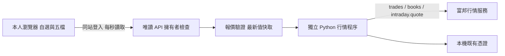

# 富邦盤中唯讀行情

適用本人台股證券帳戶。入口 `/morning?feed=fubon`，歷史練習保留在 `/morning`。不查詢庫存，不提供真實委託、刪單或平倉。`/api/broker/order` 持續回傳 HTTP 501 / `LIVE_LOCKED`。

## 使用方式

使用既有教室入場流程，再登入完成首次設定的本人帳號。歷史練習頁會出現「富邦唯讀行情」連結。普通學員與其他講師角色沒有行情權限；後端核對 `classroom_admin_setup` 唯一擁有者、已驗證帳號與已接受聲明的講師資料。

預設自選 2330、2317、2454，可加入／移除四位數上市櫃股票，每個裝置儲存最多 20 檔。選擇商品切換真實五檔。缺檔保留空白，不補生成資料。數量保留富邦原始 size，不自行換算；尚未取得此帳戶產品的正式單位確認前，畫面不標示為股或張。

網頁每秒讀取最新彙整值，會合併此秒內多次更新，並非逐筆成交錄影。成交與五檔新鮮度分開顯示；15 秒未更新即標為舊資料，冷門股無成交也會如此。心跳僅代表連線，不能刷新價格時間。試撮價不替換最後真實成交；收盤保留日期與最後資料。

## 接線與維運

- `FUBON_READONLY_ENABLED=true` 才能啟動，預設關閉。已授權網頁開始讀取時才登入。
- 使用既有外部環境 `%USERPROFILE%/YilutekServices/DayTradeTycoon/fetcher/.venv/Scripts/python.exe`，鎖定 fubon_neo 2.4.0 / fugle-marketdata 2.7.0rc1。升級需重新驗證。
- 沿用 `%USERPROFILE%/.fubon/credentials.local.py`，以 AST 讀取，不執行設定檔。前端不含帳密、憑證、SDK token 或帳號清單。SDK 原始輸出不回傳瀏覽器；原生 SDK 自行產生的日誌留在受限的私有 runtime `fubon-readonly/work`，不進入 repo 或公開檔案。
- worker 隨不可變版本封裝至 `server/fubon-live/worker.py`；hosting 的 `hostedAppPaths` 指向該版本。可用 `FUBON_READONLY_PYTHON`、`FUBON_READONLY_CREDENTIALS` 覆寫本機位置。
- 每個應用程序共用一條行情連線，最多 8 分頁、合計 30 檔（60 個 channel 訂閱）。同股訂閱合併；超額明確拒絕。隱藏分頁停止輪詢，45 秒無讀取釋放訂閱；全部離開會登出。目前服務是單程序，未支援多機共享鎖，不可直接擴成多個 instance。
- 訂閱確認逾時 20 秒、worker 無回應 30 秒、行情無心跳／資料 70 秒會重建連線。退避約 5／10／20／40／60 秒加隨機延遲，連續失敗最多 8 次後暫停。穩定連線 120 秒才重置失敗計數。
- 重連重新登入、重新訂閱並補完整快照。新連線世代拒收舊 callback；舊價保留警示，直到本世代取得資料。每日 serial 重置不會擋住今日新成交。
- 新代碼先查詢 `intraday.ticker` 再訂閱；不存在的商品只顯示該列錯誤，不中斷其他股票。若券商提供當日漲跌停價，拒收超出該日期價格範圍的成交／五檔；沒有提供時不擅自套用固定 10% 或調整資料。
- REST 每秒最多 2 次、每股每 60 秒補快照，30 檔穩態約 30 次／分；429 全域等待 65 秒。其他工具若共用帳戶，仍須合併計算配額。
- 登入／憑證／版本錯誤直接暫停；修正本機設定後，以既有 `host.ps1 stop` / `start` 重啟。重新整理頁面不清除認證錯誤鎖，避免重複撞登入。
- 停用方式：將私有 `secrets/app.env` 的 `FUBON_READONLY_ENABLED=false`，再重啟服務。歷史重播與模擬帳本不依賴此行情 worker。

## 驗證結果與界線

2026-10-23 開盤前，使用既有憑證完成真實唯讀登入。2330、2317 的成交與五檔快照取得成功；Chrome 另加入 6488（上櫃環球晶）成功取得五檔。

- 最終真實 WebSocket 斷開：台北 07:01:34 顯示重連，07:01:43 完成新世代登入、訂閱與快照，約 9 秒；9999 錯誤代碼未影響其他股票。證據 `artifacts/fubon-live-probe-2026-10-23.json`。
- 行情程序中止：自動重建成功，約 10 秒。證據 `artifacts/fubon-live-worker-crash-2026-10-23.json`。
- 資料時間為 2026-10-22 13:30，重連後仍為舊資料，`tradeFresh=false`，沒有替換成測試當下時間。
- 真實 HTTP：本人成功讀取；無入場 403、無帳號 401、學員 403、跨來源 403、行情寫入 405、真實下單 501。回應 `private, no-store`。證據 `artifacts/fubon-live-http-2026-10-23.json`。
- 離線案例包含舊世代、重複、亂序、serial 跨日、試撮、倒掛、空簿、異常數值、過期、訂閱與容量限制。

尚未以盤中實際新成交驗證持續推送、忙碌股票長時間負載、整個交易日、停牌／漲跌停與券商大規模故障。本次開盤前快照與故障測試不等同盤中全時段驗收，也不保證永不斷線。國票與真實下單未啟用。

## 10/23 首次發布與驗收（歷史）

- 正式入口：https://rich.yilutek.com/morning?feed=fubon 。版本 `20261022T230320858Z`，315 個發布檔案，台北 2026-10-23 07:05 由既有 `DayTradeTycoonHost` 排程啟動。健康檢查 HTTP 200，47 個公開 JS／CSS SHA-256 全數相符。
- 切換前已確認 DB 乾淨關閉；備份 `C:/Users/kevin/YilutekServices/DayTradeTycoon/backups/2026-10-22T23-04-18-832Z`，1,061 檔逐一驗證。保留回退版本 `20261022T161603264Z`。`hosting.json` 僅切換 `appEntry`；私有環境設定僅新增／設定 `FUBON_READONLY_ENABLED=true`，未變更既有帳密或教室設定。
- 完整測試：945 項，941 通過，4 項依環境略過；另以建置伺服器執行其中 daily／guest／morning 的 3 項 HTTP 整合，全數通過。僅 on-prem 封裝測試仍未執行，本次不發行地端 ZIP。行情與交易保護專項 53 項通過；型別、修改範圍 ESLint、建置通過。
- 最終建置的隔離 HTTP 服務以假學員／本人帳號驗證存取限制，並使用既有富邦憑證取得真實快照；測試 DB 與正式 DB 完全分開。測試服務已關閉。
- 外部 Chrome 登入後驗收使用隔離環境與真實富邦來源，涵蓋 1366×900、820×900、375×812、320×700 大字；窄螢幕直接顯示資料時間與舊資料警示，無整頁水平溢出。自選加入上櫃 6488 與五檔成功；尺寸已還原。驗收圖 `artifacts/fubon-readonly-desktop-2026-10-23.png`。
- Chrome 記錄出現 storage access 訊息，其中有擴充套件來源；不將本次驗收描述為瀏覽器零錯誤。行情讀取、操作與顯示持續正常。
- 正式網站公開入口與權限保護已驗證；目前正式 Chrome 未登入本人帳號，故 `authenticatedProductionUi=false`。正式登入後畫面不可與隔離環境登入後驗收混稱。伺服器的真實下單端點另以公開網址驗證，持續 501 / `LIVE_LOCKED`。
- 正式入場頁另以 Chrome 逐一核對 1366×900、820×900、375×812、320×700，均無整頁水平溢出；這是未登入入場頁驗收。紀錄 `artifacts/fubon-public-browser-2026-10-23.json`。測試尺寸已清除，正式行情入口分頁保留供本人登入。
- 發布證據：`artifacts/fubon-live-deployment-2026-10-23.json`、`artifacts/fubon-live-public-feed-2026-10-23.json`、`artifacts/fubon-live-public-2026-10-23.log`。

## 重跑驗證

2026-10-24 初次正式本人驗收：已取得台積電、鴻海、聯發科及環球晶報價／五檔，權限、讀取與股票切換通過，時間仍為 10/22 13:30 且正確標舊資料。`authenticatedProductionUi=true` 僅表示這次本人登入的正式資料畫面已驗；當時全項結果為 `PARTIAL_PASS_DISPLAY_DEFECT`，因 320 像素大字五檔最右委賣量裁切約 17px，當時尚未修正。歷史證據見 `artifacts/fubon-owner-ui-2026-10-24.json`，不改寫前一日未登入的紀錄。

2026-10-24 後續修正已發布至 `20261024T002006781Z`：320 大字五檔完整顯示，數字仍為 22px；四尺寸、四檔商品與正式本人權限重驗通過。另禁止行情 Python 子程序在不可變 release 內產生快取。中間版的檔案異動失敗證據完整保留，最終版重新核對。最新收據 `artifacts/fubon-fixed-final-ui-complete-2026-10-24.json`，發布紀錄 `docs/fubon-layout-release-2026-10-24.md`。真實下單持續 `LIVE_LOCKED`；盤中新成交、五檔跳動及整日穩定性仍按 `docs/fubon-session-acceptance-2026-10-27.md` 的 10/27 原時程驗收。

- `npm run test:broker`：離線資料與下單封鎖測試。
- `node --experimental-strip-types scripts/verify-fubon-live.mjs`：會真實登入富邦，只讀行情，主動斷開該測試自己的 WebSocket 並驗證重連；不操作其他服務程序。不要同時執行多份。
- `node scripts/verify-fubon-http.mjs`：隔離 DB 與假帳號驗證權限，預設不連券商。
- `node scripts/verify-fubon-http.mjs --live --serve`：隔離服務連真實行情，於 127.0.0.1:18824 供 Chrome 驗收。建立 `artifacts/fubon-qa-stop` 檔案後結束並關閉 DB；啟動前移除上次停止檔。測試登入資訊只適用隔離環境。

測試專用斷線命令僅在本機 worker 以 `--verification` 啟動時接受；正式服務不啟用此旗標，HTTP 沒有斷線注入端點。

## 官方依據

- [WebSocket 連線、訂閱與心跳](https://www.fbs.com.tw/TradeAPI/docs/market-data/websocket-api/getting-started/)
- [成交訊息與試撮旗標](https://www.fbs.com.tw/TradeAPI/docs/market-data/websocket-api/market-data-channels/trades/)
- [最佳五檔完整資料](https://www.fbs.com.tw/TradeAPI/docs/market-data/websocket-api/market-data-channels/books/)
- [Intraday Quote 快照](https://www.fbs.com.tw/TradeAPI/docs/market-data/http-api/intraday/quote/)
- [商品資訊與漲跌停價](https://www.fbs.com.tw/TradeAPI/docs/market-data/http-api/intraday/ticker/)
- [請求與訂閱限制](https://www.fbs.com.tw/TradeAPI/docs/market-data/rate-limit/)
